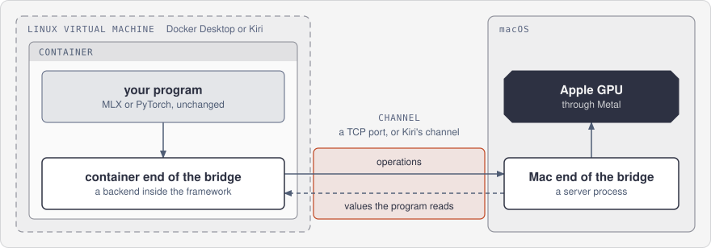

<h1 align="center">
  <picture>
    <source media="(prefers-color-scheme: dark)" srcset="docs/assets/logo-dark.svg">
    
  </picture>
</h1>

**Linux containers on a Mac that compute on the Mac's Apple GPU, with
programs that are not changed.**

On a Mac, containers run inside a Linux virtual machine, and Metal, the only
way to the Apple GPU, does not reach into it. A program that uses MLX or
PyTorch therefore runs on the CPU as soon as it is put in a container. varco
is a bridge across that barrier (*varco* is Italian for a gap opened in a
barrier): the operations the program issues are intercepted inside the
container and executed by a process on the Mac, on the real GPU, and the
results come back.

There are two bridges, one per framework:

- **MLX**: a "remote" gpu backend for MLX 0.32.4 on Linux, and a C++ server
  on the Mac that runs the graphs on the stock MLX library.
- **PyTorch**: an MPS backend for PyTorch 2.15.0 on Linux whose single
  kernel forwards every operation to the Mac, where a process per program
  runs it on the real MPS.

The program in the container is an ordinary one. It sees
`mx.default_device()` as the GPU and `torch.backends.mps.is_available()` as
`True`, and needs to be told nothing else.

varco is an experimental prototype, written by one person and measured on
one machine (Apple M4 Max, 128 GB, macOS 26.6.2). What it runs and what it
does not is in [docs/compatibility.md](docs/compatibility.md).

The channel to the GPU is what varco is for: a container that has it
computes on the Mac's GPU and uses the Mac's memory, as a program you start
on the Mac does. The Mac end runs only the operations on its list (114 MLX
primitives, each with a rule on its inputs, and 1,972 of PyTorch's 3,120
operators), refuses anything else, reads model files only under the
directories you name, and refuses GPU programs written by a container
unless you turn them on. Which containers get the channel is your choice:
give it to containers you run yourself, or trust as you would a program you
start on the Mac. [docs/security.md](docs/security.md) has the facts behind
this paragraph.

## How it works

<picture>
  <source media="(prefers-color-scheme: dark)" srcset="docs/assets/overview-dark.svg">
  
</picture>

The bridge works at the level of array operations, not of models or of
pixels. The container sends a description of the computation (an MLX graph,
a PyTorch operator call) and the Mac sends back only the values the program
reads. Model weights are not copied through the bridge when the Mac can read
their file itself. [docs/architecture.md](docs/architecture.md) follows one
operation from the program to the GPU and back.

With Docker Desktop the container reaches the server on a TCP port of the
Mac. With [Kiri](https://github.com/libracoder/kiri), a container engine for
which this repository carries two patches, a container started with
`--gpus all` finds its bridge at `127.0.0.1:47700` inside its own network,
and a container started without it finds none.

## Quick start

You need a Mac with Apple silicon and macOS 14 or later, Docker Desktop, the
Xcode command line tools and [`uv`](https://docs.astral.sh/uv/).

```sh
git clone https://github.com/FabioMalpezzi/varco.git && cd varco
scripts/setup-mac.sh           # checks the Mac, builds both bridges, tries each one
scripts/fetch-models.sh        # four small public models, about 3.3 GB
examples/01-embeddings/run.sh  # MLX: BGE-M3 embeddings in a container, on the GPU
examples/03-pytorch-inference/run.sh   # PyTorch: transformers in a container, on the GPU
```

`setup-mac.sh` says what is missing and how to get it, and can be run again
at any time. The container images are not published on a registry: the
script builds them on your Mac. On the machine above that took 244 seconds
from a fresh clone, of which 146 for the three MLX images, which compile MLX
for Linux, and 68 for the PyTorch image. The Python packages for the Mac
and Docker's base images were already downloaded, and a second run took 4
seconds.
[docs/setup.md](docs/setup.md) has the requirements, the two engines, the
diagnosis (`scripts/doctor.sh`), keeping the servers running from login,
updating and uninstalling.

Each example starts the server it needs, runs an ordinary program in a
container, and stops the server. Add `native` to run the same program on the
Mac directly and compare the output:

```sh
examples/01-embeddings/run.sh native
```

[docs/quickstart.md](docs/quickstart.md) goes through the same steps one at a
time, for Docker Desktop and for Kiri, and says what each one prints. With
Kiri the same scripts take `ENGINE=kiri` in front.

If you work with a coding agent, hand it
[docs/agent-install.md](docs/agent-install.md): it has the same steps with
the result that ends each one, and the four choices the agent must ask you
about before it builds anything.

## What was measured

All on one machine, the same program on the Mac directly ("native") and in a
container through the bridge. A result counts as identical when the SHA-256
of its bytes is the same on both sides. The full tables, the method and the
limits of each figure are in [docs/benchmarks.md](docs/benchmarks.md).

The released code (MLX protocol 11, PyTorch protocol 3) was run from a fresh
clone on 16 November 2026. A row that names no engine gave the same outcome
with Docker Desktop and through Kiri, whose virtual machine had 8 CPUs and
16 GiB:

| What was run | Outcome |
|---|---|
| 58 small MLX programs that cover its operations | 57 identical; 1 differs as declared, in a matrix inverse that each side computes on its own CPU |
| BGE-M3 embeddings, MLX, 1 / 8 / 32 sentences | identical; 1.11 / 1.12 / 1.11 times the Mac's time with Docker Desktop (one sentence in 10.7 ms, 9.6 on the Mac) and 1.01 / 1.02 / 1.02 through Kiri (9.7 ms) |
| Qwen3.6-35B-A3B-4bit generation, mlx-lm, custom kernels on | identical text; in the container 130 tokens/s in the first generation of a run and 141 in the second, on the Mac 129–135, with one generation at 125 and one later run at 138 |
| 38 custom Metal kernel cases, Docker Desktop | 29 of 29 that run identical; 5 raise the same error on both sides; 4 refused on purpose |
| MLX's own 926 Python tests, Docker Desktop | 1 fails on the Mac and 19 in the container, and 30 more are skipped in the container, where MLX finds custom kernels off; with a server that takes custom kernels none is skipped and 23 fail in the container; all are declared in the comparison |
| 47 PyTorch inference programs | 47 identical |
| 68 PyTorch training programs | 63 or 62 identical, depending on the run; 3 or 4 within the declared tolerance, where two runs on the Mac differ too; 2 fail on both sides alike |
| GPT-2 generation, PyTorch, one run inside the 47 programs | 411 tokens/s with Docker Desktop and 475 through Kiri, where the Mac gave 579 and 581 |

Measured between 12 and 15 November 2026 on the code before the review fixes
(MLX protocol 9, PyTorch protocol 1), through Kiri:

| Program | Native | In a container |
|---|---|---|
| mlx-lm's OpenAI-compatible server, one request of 120 tokens | 1.120 s | 0.884 s, identical text |
| The same server, 4 requests at once | 216.0 tokens/s in total | 215.0 tokens/s in total; text differs from the Mac's in 1 pair of 4 |
| A segmentation training with Lightning and 16-bit autocast, private project | 2.477 s/step | 2.463 s/step; first step identical, later steps differ as two Mac runs do |
| A point-network training pilot, private project | 0.026 s/step | 0.030 s/step; loss and weights identical to the bit |

What the tables do not show, and the benchmarks page does:

- The bridge has a cost where a program reads values. An operation whose
  answer is in the values (`.item()`, `nonzero`, a comparison used by an
  `if`) costs the PyTorch bridge one round trip, 150–200 µs. Steps of 26 ms
  pay 13% for it, and steps of 2.5 s pay nothing measurable.
- Throughput stops growing with the number of containers. Containers on one
  MLX server share one stream of work, and two of them reach 129 tokens/s in
  total where two processes on the Mac reach 176. The Apple GPU itself gives
  separate programs about 1.4 times the throughput of one, and no more
  ([docs/apple-gpu-limits.md](docs/apple-gpu-limits.md)).
- Many rows are single runs, and none was repeated on another machine.

## Use cases

Each has a page that says who it is for, the commands, what you see, the
measured figures and the limits, and a runnable example.

| | Use case | Example |
|---|---|---|
| 1 | [Embeddings in a container](docs/use-cases/embeddings.md) (BGE-M3, MLX) | [`examples/01-embeddings`](examples/01-embeddings/) |
| 2 | [An OpenAI-compatible model server in a container](docs/use-cases/openai-server.md) (mlx-lm's server) | [`examples/02-openai-server`](examples/02-openai-server/) |
| 3 | [PyTorch inference](docs/use-cases/pytorch-inference.md) (transformers) | [`examples/03-pytorch-inference`](examples/03-pytorch-inference/) |
| 4 | [PyTorch training](docs/use-cases/pytorch-training.md) (Lightning, mixed precision, checkpoints, resuming) | [`examples/04-pytorch-training`](examples/04-pytorch-training/) |
| 5 | [The same Compose file on a Mac and on an NVIDIA server](docs/use-cases/same-compose-nvidia.md) | [`examples/05-same-compose-nvidia`](examples/05-same-compose-nvidia/) |
| 6 | [Several containers at once](docs/use-cases/several-containers.md) | [`examples/06-several-containers`](examples/06-several-containers/) |
| 7 | [Custom Metal kernels](docs/use-cases/custom-kernels.md) | [`examples/07-custom-kernels`](examples/07-custom-kernels/) |

## Limits to know before you start

- Everything was built and measured on one machine. Nothing here was run on
  another Mac, on another macOS, or under sustained load.
- The versions are pinned: MLX 0.32.4 and PyTorch 2.15.0, the same on both
  ends. Each end refuses the other when its version differs.
- What the Mac cannot do, the container cannot do either. PyTorch has no
  float64 on the GPU, there are no CUDA extensions, and the operators MPS
  lacks fail with the Mac's own error.
- Containers that share one MLX server are not separated from each other,
  and custom Metal kernels are off unless you turn them on
  ([docs/security.md](docs/security.md)).
- Kiri's channel is two patches against one commit of Kiri, not part of
  Kiri.

[docs/compatibility.md](docs/compatibility.md) has the full list, and
[docs/roadmap.md](docs/roadmap.md) says what could be done about each item
and what was decided against.

## Repository layout

| Directory | What is in it |
|---|---|
| [`mlx/`](mlx/) | The MLX bridge: the patch against MLX v0.32.4, the Mac server, the images, the tests, reference results |
| [`pytorch/`](pytorch/) | The PyTorch bridge: the container's backend, the Mac end, the image, the compatibility batteries |
| [`kiri/`](kiri/) | Two patches against Kiri: the GPU channel for `--gpus` containers, and a memory-balloon fix found while measuring |
| [`examples/`](examples/) | One runnable example per use case |
| [`docs/`](docs/) | Architecture, protocols, measurements, limits, security, roadmap |
| [`scripts/`](scripts/) | Install, diagnose, keep the servers running from login, run the tests, the checks the CI runs |

## Documentation

- Start: [setup](docs/setup.md), [quick start](docs/quickstart.md),
  [FAQ](docs/faq.md), [troubleshooting](docs/troubleshooting.md),
  [glossary](docs/glossary.md)
- Understand: [architecture](docs/architecture.md),
  [MLX protocol](docs/protocol-mlx.md), [PyTorch protocol](docs/protocol-pytorch.md),
  [security](docs/security.md),
  [custom Metal kernels](docs/use-cases/custom-kernels.md)
- Trust: [benchmarks and tests](docs/benchmarks.md),
  [what the Apple GPU allows](docs/apple-gpu-limits.md),
  [compatibility](docs/compatibility.md)
- Context: [related work](docs/related-work.md), [roadmap](docs/roadmap.md),
  [development](docs/development.md)

## Licence

MIT for the code and documents of this repository; the patches under
`kiri/patches/` are Apache-2.0, as Kiri is. See [LICENSE](LICENSE) and
[NOTICE](NOTICE) for the attributions to MLX, PyTorch and Kiri. This project
is not affiliated with Apple, the MLX or PyTorch projects, or Kiri.
