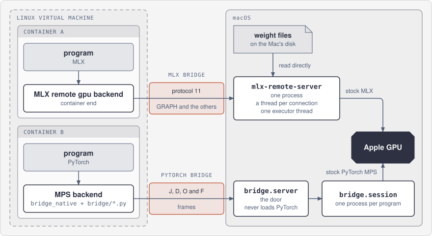
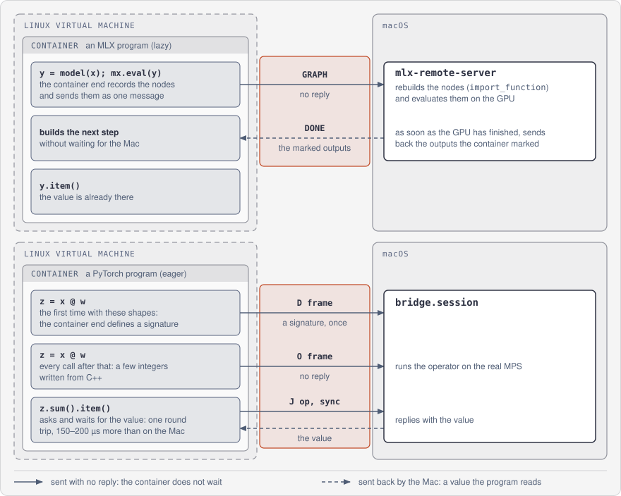
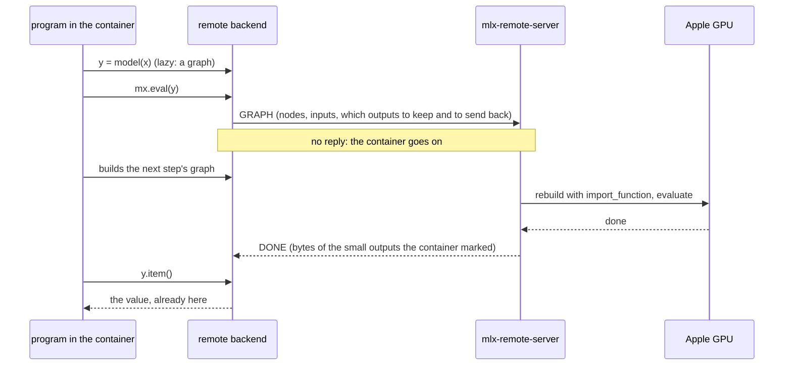
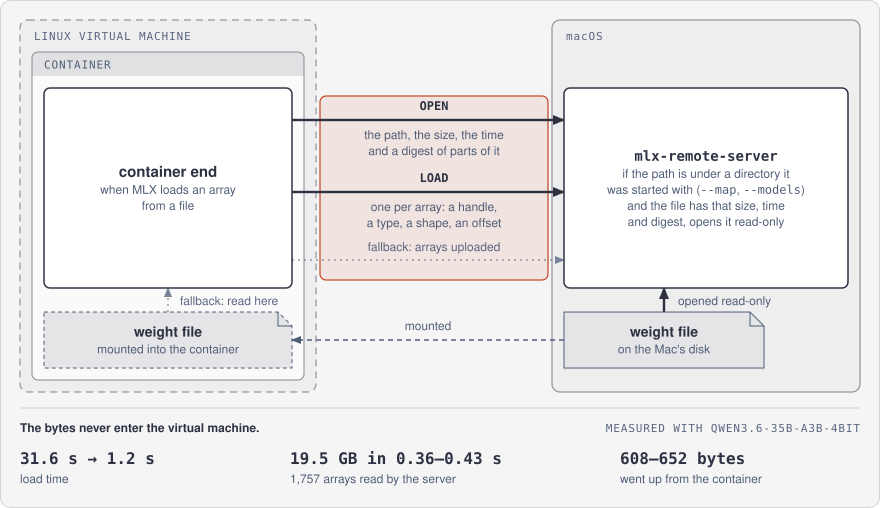
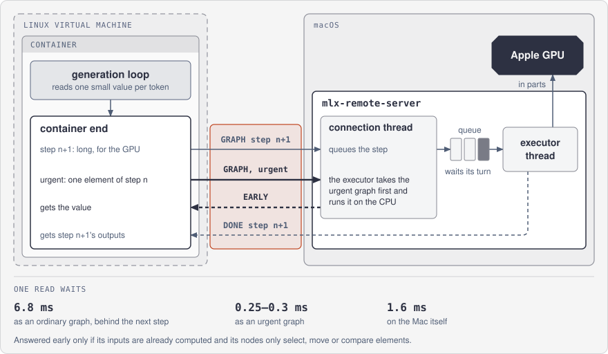
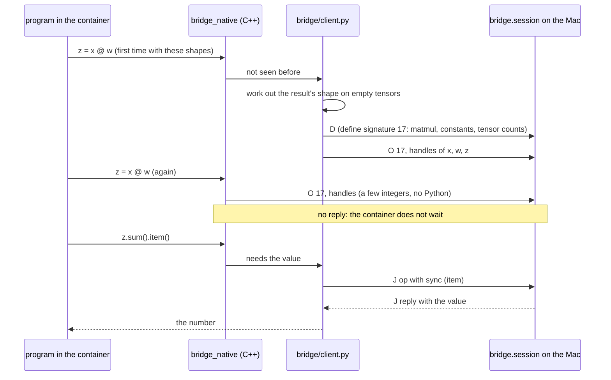
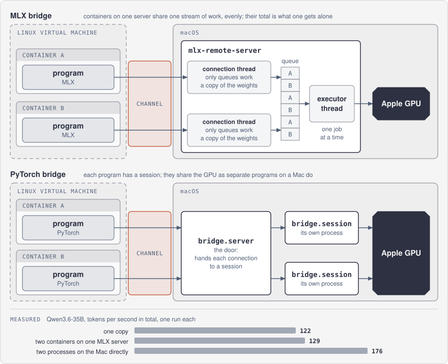
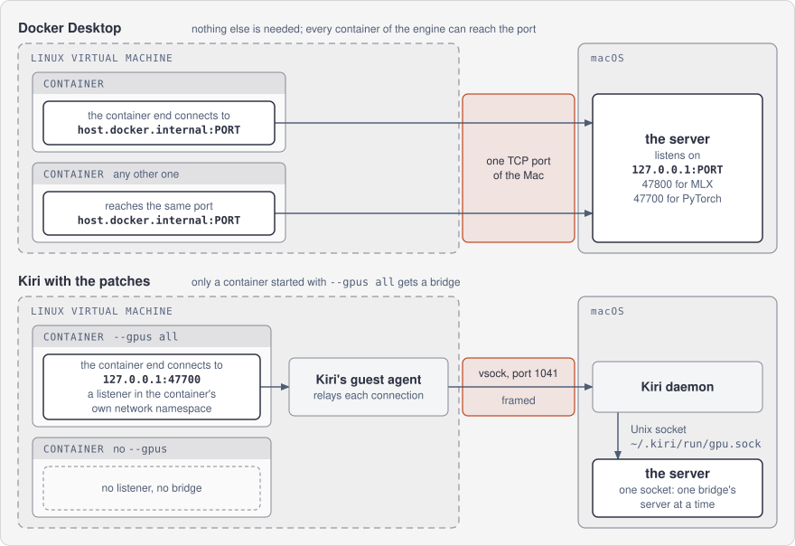

# Architecture

This is how the two bridges work, as read from the code in this repository. The
terms are in the [glossary](glossary.md), and the exact bytes are in
[protocol-mlx.md](protocol-mlx.md) and
[protocol-pytorch.md](protocol-pytorch.md).

## The problem

On a Mac a container is a Linux process inside a virtual machine. The Apple
GPU is reached only through Metal, which exists only on macOS, and the
virtual machine is given no device that speaks it. Inside a container MLX has
no GPU device at all, and PyTorch for Linux has no MPS: programs fall back to
the CPU.

Passing the GPU through as a device would mean carrying a graphics API across
the virtual machine. The bridges do something narrower: they carry the
**array operations** of one framework. The framework inside the container is
given a backend that, instead of computing, describes each operation to a
process on the Mac, and the same framework on the Mac computes it. Because
both ends run the same version of the same framework, the results are the
Mac's own, most of the time to the bit ([benchmarks](benchmarks.md)).

<picture>
  <source media="(prefers-color-scheme: dark)" srcset="assets/two-bridges-dark.svg">
  
</picture>

The two bridges are independent. They share an idea and the transport, not
code.

## The path of one operation

<picture>
  <source media="(prefers-color-scheme: dark)" srcset="assets/operation-path-dark.svg">
  
</picture>

In both bridges most messages have no reply, so the container does not wait
for the Mac. What comes back is a value the program reads. The two sections
below follow each bridge in detail. The 150–200 µs in the figure were
measured at PyTorch protocol 1 with PyTorch 2.15.0, in a Docker Desktop
container on an Apple M4 Max with 128 GB
([benchmarks](benchmarks.md#cost-of-small-operations)).

## The MLX bridge

### Container end

MLX is lazy: operations build a graph, and nothing is computed until a value
is needed. The container's MLX is upstream MLX 0.32.4 built for Linux with
one more backend, `mlx/backend/remote` ([the patch](../mlx/patches/), 27
files). In that build the gpu device is not Metal: it is the connection to
the Mac.

- A node evaluated on a gpu stream is **recorded** instead of computed. Its
  outputs get buffers that stand for arrays on the Mac, named by handles the
  container chooses.
- At the end of an evaluation the recorded nodes are sent as one **GRAPH**
  message. Each node travels as the bytes MLX's own `export_function` writes
  for a primitive, so the Mac can rebuild it with `import_function`: no
  operator table is duplicated in the bridge.
- Most messages have no reply. The container does not wait for the Mac while
  it builds the next graph. An error is kept by the server and returned with
  the next message that has a reply.
- When the program reads a value, the bytes are usually already there: the
  container marks which outputs of a graph it expects to read, and the Mac
  sends them by itself in a **DONE** frame as soon as the GPU has finished.
  Large outputs travel in a separate **MORE** frame so that they do not hold
  back the small ones.
- Long evaluations are sent in parts while they are still being recorded, so
  that the Mac starts on the first nodes immediately.
- What `mx.compile` fuses, scaled dot-product attention, `contiguous`, and
  the fused cross entropy with its gradient are sent as single nodes and
  rebuilt on the Mac by calling MLX there, because how they are computed
  depends on the GPU.

### Mac end

[`mlx-remote-server`](../mlx/server/mlx_remote_server.cpp) is one C++ file
linked against the stock MLX library of the same version. It keeps a table
of handle to array per connection and does only this: store uploaded data,
check, rebuild and evaluate graphs, send array bytes back, free handles, and
read weight files under the directories it was started with.

A container is not trusted to send well-formed graphs. Before a node is
given to MLX the server checks it against a rule for its primitive: how
many arrays go in, which axes, shapes and types go in and come out. There
are rules for 114 primitives, read from the operations that make each one in
MLX 0.32.4, and a primitive without a rule is refused
([protocol](protocol-mlx.md#what-the-server-checks-of-a-graph)).

It has a thread per connection, which only queues work, and **one executor
thread** that runs it, one job at a time. That single executor is the limit
measured in [several containers at once](use-cases/several-containers.md):
containers on one server share one stream of work.

### The life of one evaluation

### Weights read by the Mac

A model's weights are tens of gigabytes that the container has no use for.
When MLX loads an array from a file, the container sends **OPEN** with the
file's path, its size, the time it was last modified and a digest of parts
of it (its first and last 64 KiB and sixteen parts in between). If the path,
after the server's `--models` or `--map` mapping and with symlinks and `..`
resolved, is under an allowed directory and the file there has that size,
that time and that digest, the Mac opens it read-only, and each array
becomes a **LOAD** message: a handle, a type, a shape, an offset. The bytes
never enter the virtual machine.

<picture>
  <source media="(prefers-color-scheme: dark)" srcset="assets/weights-dark.svg">
  
</picture>

The figures in the diagram were measured with Qwen3.6-35B-A3B-4bit in Kiri,
on an Apple M4 Max with 128 GB. The load took 31.6 s at MLX protocol 4, in
one run with the weights going through the container, and 1.2 s at protocol
7, with the Mac reading them, in runs alternated with the Mac. The virtual
machine went from 40 GB to the default 8 GB. The server read 1,757 arrays,
19.5 GB, in 0.36–0.43 s, while 608–652 bytes went up from the container
([benchmarks](benchmarks.md#speed-qwen36-35b-a3b-4bit-with-mlx-lm-0322)).

If the Mac cannot or may not read the file (a compressed archive, a path no
mapping covers, a file that changed), the container reads it and uploads the
arrays, as for any other data, and says so on its standard error. The result
is the same; only the cost differs.

### Urgent reads

A generation loop reads one small value per token (a sampled token, a
`logprobs[token].item()`). Sent as an ordinary graph, that read queued on the
Mac behind the next step, which the container had already sent: it waited
6.8 ms where the Mac itself waits 1.6 ms, and mlx-lm's server was slower in
the container than on the Mac.

A small graph whose result the program is about to read is therefore
marked **urgent**. If all its inputs are already computed and its nodes only
select, move or compare elements, which gives the same bytes on any device,
the executor takes it out of the queue first, runs it on the CPU, and
answers with an **EARLY** frame. A long step is handed to the GPU in parts
so that an urgent graph waits 0.25–0.3 ms. Otherwise the graph takes its
turn. An urgent graph also takes its turn while a failure of an earlier
message is still to be told, so that an early answer never hides one.
mlx-lm is not changed. The before and after are in
[benchmarks](benchmarks.md#a-model-server-in-a-container-mlx-lms-own).

<picture>
  <source media="(prefers-color-scheme: dark)" srcset="assets/urgent-reads-dark.svg">
  
</picture>

The figures in the diagram are from the measurements of mlx-lm's server
with Qwen3.6-35B-A3B-4bit on an Apple M4 Max with 128 GB: the 6.8 ms and
the 1.6 ms at MLX protocol 8, for which the engine was not written down,
and the 0.25–0.3 ms at protocol 9 in a Kiri container
([benchmarks](benchmarks.md#a-model-server-in-a-container-mlx-lms-own)).

### Custom Metal kernels

Some libraries write their own Metal kernels with `mx.fast.metal_kernel`
(mlx-lm does, for some layers of some models). A kernel is source code that
the GPU compiles and runs, so the server takes them only when started with
`--custom-kernels`:

- Without the option, `mx.metal.is_available()` is `False` in the container,
  and libraries take their ordinary path. The results are right but can
  differ from the Mac's, and are slower where the kernel was the fast path:
  Qwen3.6-35B gave 105 tokens instead of 93, at 118–119 tokens per second
  where the Mac gives 130–136.
- With the option, each kernel is sent once per connection (**KERNEL**), the
  server compiles it with MLX's own `metal_kernel`, and nodes refer to it by
  number. Sources with `#include`, `#import` or `#pragma`, over 256 KiB, or
  more than 256 kernels per connection are refused. A kernel goes when the
  last connection that sent it closes.

What the option implies, the commands that turn it on and off and the whole
list of what is refused are in
[use-cases/custom-kernels.md](use-cases/custom-kernels.md).

## The PyTorch bridge

PyTorch is eager: every operation is computed when it is called, and
programs read values all the time. The design is therefore different.

### Container end

The image holds the stock CPU build of PyTorch for Linux and two additions:

- [`bridge_native`](../pytorch/bridge/native.cpp), a C++ module loaded before
  `torch`. It registers a device guard and hooks so that PyTorch believes
  there is an MPS device, and one fallback kernel for the MPS dispatch key.
  A tensor "on mps" in the container has a shape, a type and no data: the
  data is on the Mac, under a number.
- [`bridge/*.py`](../pytorch/bridge/), which handles what is rare: an
  operation seen for the first time, data moving to or from the GPU,
  operations whose answer is in the values, saving and loading, seeds.

A `.pth` file makes every Python process of the image load the bridge when it
imports `torch` ([`auto.py`](../pytorch/bridge/auto.py)), so
`python train.py` is all it takes, and the processes a program starts (data
loader workers, subprocesses) get it too. `BRIDGE=0` turns it off.

Because the tensors are real MPS tensors to PyTorch, every operation is
decomposed exactly as on a Mac (`linear` and attention stay whole) and ends
at the one kernel. That kernel takes an operator whole only if the Mac's
PyTorch has an MPS kernel for it; the list is generated per PyTorch version
on a Mac ([`gen_ops.py`](../pytorch/gen_ops.py),
[`bridge/ops/`](../pytorch/bridge/ops/)). This is why an operator MPS lacks
fails in the container with the Mac's own `NotImplementedError`.

### The life of one operation

- An operation seen before with the same shapes and constants is a few
  integers written to the socket from C++: its signature number and the
  handles of its tensors and results. Nothing is waited for.
- The first time, Python works out the result's shape by running the
  operation on empty (meta) tensors, or asks the Mac when PyTorch cannot,
  and defines the signature for both ends.
- Operations whose answer is in the values (`.item()`, `nonzero`, a
  comparison used by an `if`, an index by a mask) wait for the Mac: one
  round trip each, 150–200 µs more than on the Mac
  ([benchmarks](benchmarks.md#cost-of-small-operations)). This is the
  bridge's fixed cost, and what makes short steps slower.

### Mac end: a process per program

[`bridge.server`](../pytorch/bridge/server.py) is a small process that never
loads PyTorch. It accepts a connection, reads the greeting (the protocol
version, the container's PyTorch version and its MPS settings), and hands
the connection to a
[`bridge.session`](../pytorch/bridge/session.py) process, of which it keeps
one ready so that connecting does not wait for PyTorch to load. The session
runs the operations on the real MPS; its hot path is C++
([`executor.cpp`](../pytorch/bridge/executor.cpp)), with Python doing the
same when the extension is not built.

A process per program gives a container's program what a program has on a
Mac: its own GPU memory, given back entirely when the process ends however
the program ended; its own random generators and MPS settings; and a failure
(running out of GPU memory) that takes down only itself. It is also why
several PyTorch containers share the GPU as separate programs on a Mac do.

<picture>
  <source media="(prefers-color-scheme: dark)" srcset="assets/several-containers-dark.svg">
  
</picture>

What several containers get from each arrangement is in
[use case 6](use-cases/several-containers.md). The three totals in the
figure were measured with Qwen3.6-35B at MLX protocol 9, on an Apple M4 Max
with 128 GB, the containers in Kiri with 6 CPUs, in one run for each
configuration
([benchmarks](benchmarks.md#several-containers-at-once-and-where-it-stops-scaling)).

The session runs only the operators on a list made from PyTorch's own
declarations, 1,972 of the 3,120 of PyTorch 2.15.0, on arguments that are
plain data of the kind each operator's schema takes
([`policy.py`](../pytorch/bridge/policy.py)). The messages are JSON, not
pickle: the Mac never runs code the container chose.

## The channel

Both bridges speak over a byte stream. Where it runs depends on the engine.

<picture>
  <source media="(prefers-color-scheme: dark)" srcset="assets/channels-dark.svg">
  
</picture>

**Docker Desktop.** The server listens on a loopback TCP port of the Mac and
the container connects to `host.docker.internal`. Every container of the
engine can reach that port.

**Kiri.** With [the patches](../kiri/README.md), a container created with a GPU
request (`--gpus all`, or Compose's `capabilities: [gpu]`) on an
Apple-silicon Mac gets a listener at `127.0.0.1:47700` inside its own
network namespace, opened by Kiri's guest agent before the program starts.
Each connection is relayed over vsock to the daemon on the Mac, which
connects it to the Unix socket `run/gpu.sock` in Kiri's state directory,
where the bridge's server listens. Kiri sets `KIRI_GPU_BRIDGE=127.0.0.1:47700`
in the container, and both bridges connect there unless the container is
given another address (`MLX_REMOTE`, or `BRIDGE_HOST` and `BRIDGE_PORT`). A
container without the GPU request has no such listener. `--network host` or
`container:` is refused together with `--gpus`, and no container may join
the network namespace of a `--gpus` container, because the listener would
then be shared.

There is one socket, so with Kiri one bridge's server is up at a time, and
it listens on the socket only: Kiri forwards `host.docker.internal:PORT` of
every container to the Mac's loopback, so a server on a TCP port would be
reached by containers started without `--gpus` too.

Kiri's channel is the faster of the two for short steps. On the released
code BGE-M3 took 1.01 / 1.02 / 1.02 times the Mac's time in Kiri and 1.11 /
1.12 / 1.11 with Docker Desktop, for 1 / 8 / 32 sentences
([benchmarks](benchmarks.md#kiri-and-docker-desktop-compared)).

## What the design does not do

- It does not virtualise the GPU. A framework that has no bridge
  (TensorFlow, JAX, raw Metal) gets nothing.
- It does not make the two ends independent. They must run the same version
  of the framework and of the protocol, and each end refuses the other when
  they differ. The versions are MLX 0.32.4 and PyTorch 2.15.0.
- It does not separate the containers that share one MLX server
  ([security](security.md#containers-that-share-one-mlx-server)). The
  PyTorch bridge gives every program its own process.
- It does not schedule. The MLX server runs jobs in arrival order (urgent
  reads aside); the PyTorch sessions share the GPU as macOS decides. See
  [apple-gpu-limits.md](apple-gpu-limits.md) and the [roadmap](roadmap.md).
