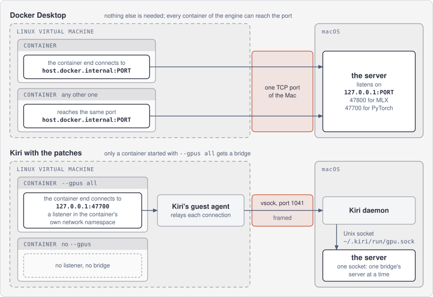

# Installing varco on a Mac

One command checks the Mac, builds both bridges and runs a small computation
through each. This page says what that command needs, what it does and how
long it takes, how the two container engines differ, and how to check,
update and remove an installation.

The commands on this page were run from a fresh clone on 16 November 2026,
on an Apple M4 Max with macOS 26.6.2: with Docker Desktop 29.2.1, and with a
Kiri built from a fresh clone with the two patches of
[`kiri/`](../kiri/README.md). One was left out: the `docker image rm` of
the last section.

## What you need

| | |
|---|---|
| A Mac with Apple silicon | The bridges compute on the Apple GPU, which an Intel Mac does not have. |
| macOS 14 or later | The MLX 0.32.4 and PyTorch 2.15.0 packages for the Mac are built for macOS 14 and later. Everything here was built and measured on macOS 26.6.2 and on no other version. |
| The Xcode command line tools | They provide `clang++` and `git`. Install them with `xcode-select --install`. |
| [`uv`](https://docs.astral.sh/uv/) | It makes the Python environments on the Mac and downloads Python 3.12 if the Mac has none. |
| A container engine that the `docker` command can talk to | Docker Desktop, running. Kiri is the other choice ([below](#docker-desktop-or-kiri)). |
| Disk space | About 4 GB for the four images, 1.7 GB for the two Python environments, and 3.3 GB for the small models of the examples. |

`scripts/setup-mac.sh` checks every row before it builds anything. If
something is missing it names it, prints the command that provides it, and
stops.

## Install

```sh
git clone https://github.com/FabioMalpezzi/varco.git && cd varco
scripts/setup-mac.sh
```

The images are built on your Mac. None is published on a registry, so there
is nothing to `docker pull`, and the first run compiles MLX for Linux inside
the build.

The script works through these steps. The times are from one run of a fresh
clone on the machine above, with `--rebuild` so that Docker reused no layer.
The base Python images and the Python packages for the Mac had been
downloaded before; on a new machine those downloads come on top.

| Step | What it makes | Time |
|---|---|---|
| The Mac's environment for MLX | `mlx/.venv` with the stock MLX 0.32.4, mlx-lm and mlx-embeddings | 2 s |
| The patched MLX source | `mlx/upstream`, MLX at the tag `v0.32.4` with the patch applied | 2 s |
| The MLX server | `mlx/server/mlx-remote-server` | 5 s |
| The three MLX images | `varco-mlx`, `varco-mlx-embeddings`, `varco-mlx-lm` | 146 s |
| The Mac end of the PyTorch bridge | `pytorch/.venv-mac-2.15.0`, the operator list, the compiled executor | 15 s |
| The PyTorch image | `varco-torch:2.15.0` | 68 s |
| One computation through each bridge | nothing; it compares a container's result with the Mac's | 6 s |
| All of it | | 244 s |

At the end the script says what is ready:

```
== Ready, in 244 s
The MLX bridge: the server and the images varco-mlx:latest varco-mlx-embeddings:latest varco-mlx-lm:latest; a container computed on this Mac's GPU.
The PyTorch bridge: the Mac end and the image varco-torch:2.15.0; a container computed on this Mac's GPU.
No server is left running: each example starts and stops the one it needs.
```

When a server was already running, one kept from login or started by hand,
the test uses it if it listens where the test looks, and the last line
names it in place of that sentence:
`Left running, as it was found: the MLX server (process 12203, port 47800).`
A block `Next:` follows, with the commands to go on with.

The test at the end is the same expression on both sides. `87.0 Device(gpu, 0)`
from a container of `varco-mlx` and `87.0 mps:0` from a container of
`varco-torch` are the values and the devices the Mac itself gives.

You can run the script again at any time. It skips every step whose result
is already there and was made from the files as they are now, so a second
run only checks and tests. On the machine above it took 4 s. A run that was
interrupted is taken up by the next one: a Python environment whose packages
were not all installed is removed and made again.

| Command | What it does |
|---|---|
| `scripts/setup-mac.sh mlx` | The MLX bridge only |
| `scripts/setup-mac.sh pytorch` | The PyTorch bridge only |
| `scripts/setup-mac.sh --rebuild` | Builds the images again without Docker's cache |
| `scripts/setup-mac.sh --no-test` | Builds and leaves out the computation at the end |

The examples also need models, which are a separate download:
`scripts/fetch-models.sh` fetches four small public ones with the `hf`
command (`uv tool install huggingface_hub`), the two for MLX into the
directory `MODELS` names. The scripts use `$HOME/models` when `MODELS` is
not set; the commands on this page that name the directory read the
variable, so set it in the shell you type them in
(`export MODELS="$HOME/models"`, or a directory of yours). The
[quick start](quickstart.md) goes on from there.

## Docker Desktop or Kiri

Both engines run the same images. They differ in how a container reaches
the server on the Mac, and in which containers can.

<picture>
  <source media="(prefers-color-scheme: dark)" srcset="assets/channels-dark.svg">
  
</picture>

| | Docker Desktop | Kiri with the patches |
|---|---|---|
| What you install | Docker Desktop, nothing else | A Kiri built from source with the two patches of [`kiri/patches/`](../kiri/README.md) |
| How a container reaches the server | A TCP port of the Mac, through `host.docker.internal` | A listener at `127.0.0.1:47700` inside the container's own network, relayed to a Unix socket on the Mac |
| Which containers reach it | Every container of the engine, and every process on the Mac | Only a container started with `--gpus all` (or Compose's `capabilities: [gpu]`), as long as no bridge server listens on a TCP port |
| Both bridges at once | Yes, on ports 47800 (MLX) and 47700 (PyTorch) | No: the channel leads to one socket, and one socket has one server |
| Speed on short steps | BGE-M3 at 1.11 / 1.12 / 1.11 times the Mac's time for 1 / 8 / 32 sentences | 1.01 / 1.02 / 1.02, with the virtual machine at 8 CPUs and 16 GiB ([benchmarks](benchmarks.md#kiri-and-docker-desktop-compared)) |

Docker Desktop works as soon as `scripts/setup-mac.sh` has finished. With
it, anything on the Mac that can open a local port can talk to a bridge
server while one is running ([security](security.md#who-can-connect)).

For Kiri, build it with the patches and start its daemon as
[`kiri/README.md`](../kiri/README.md) describes. The four build steps took
211 seconds on the machine above. Then use the engine in one of two ways:

```sh
# Build and test in Kiri itself
ENGINE=kiri scripts/setup-mac.sh

# Or build with Docker Desktop and copy the images into Kiri's own store
scripts/setup-mac.sh
docker save varco-mlx-lm:latest varco-torch:2.15.0 | DOCKER_HOST=unix://$HOME/.kiri/run/docker.sock docker load
```

Both ways were run. The build in Kiri took 207 seconds with `--rebuild`,
the Mac ends already built and Kiri's virtual machine at 8 CPUs and 16 GiB
(138 for the three MLX images, 61 for the PyTorch image). Repeated the same
day after the last changes to the code, it took 237 seconds (158 and 72).
With Kiri's default virtual machine of 2 CPUs and 8 GiB, one run from a
fresh clone into a daemon that held no image took 331 seconds, 237 of them
for the three MLX images. A second run without `--rebuild` took 4 seconds.
The copy took 3 seconds.

`docker build` against Kiri runs its builder in a container of the engine,
and that builder keeps what it builds in its own cache. The build scripts
therefore load each image into Kiri (`--load`) and give `varco-mlx` to the
two images built on it as an OCI layout. Kiri's `docker image inspect`
reports no labels, so the scripts read the label `varco.inputs` from the
image itself, with `docker save`.

`ENGINE=kiri` is read by `scripts/setup-mac.sh`, `scripts/doctor.sh`,
`scripts/autostart.sh`, the `run.sh` of every example, `pytorch/compat.sh`,
`mlx/tests/run-all.sh` and `mlx/tests/lm.sh`. With it they talk to Kiri's
socket (`~/.kiri/run/docker.sock`), start the servers on
`~/.kiri/run/gpu.sock` and on no TCP port, and start their containers with
a GPU request (`--gpus all`, or the same in Compose). Kiri forwards `host.docker.internal:PORT` of every container
to the Mac's loopback, so a bridge server on a port would be reached by
containers started without `--gpus` as well. With the server on the socket
alone, a container started without `--gpus` has no listener at
`127.0.0.1:47700` and no `KIRI_GPU_BRIDGE`. Kiri still accepts its
connection to any port of `host.docker.internal`, and closes it at once
when nothing listens on that port of the Mac.

Through Kiri's channel one bridge is reachable at a time, MLX or PyTorch:
the one whose server listens on the socket. `mlx/server/ctl.sh start`
refuses a socket that a process is listening on. `pytorch/server.sh start`
uses a PyTorch server of the same version that it finds there, leaves it
running when it is told to stop, and refuses anything else. To change
bridge, stop the server that is there and start the other
([start a server by hand](#start-a-server-by-hand)). How to run your own
containers is in the [quick start](quickstart.md#kiri).

## Check an installation

```sh
scripts/doctor.sh              # both bridges
scripts/doctor.sh mlx          # one of them
scripts/doctor.sh --quick      # without the checks that run a container
```

`doctor.sh` changes nothing. It looks at the Mac, the engine, each bridge's
two ends and the servers that are running, and prints one line for each.
A line that begins with `FAULT` has the remedy on the line under it, and the
script then exits with status 1.

```
== MLX bridge
ok       the Mac's environment: mlx 0.32.4
ok       the server is built: mlx/server/mlx-remote-server
ok       the image varco-mlx:latest has the Mac's MLX: 0.32.4
ok       a server is running on port 47800 (process 85531, started by a script (mlx/logs/server.pid)): custom Metal kernels off; it reads weights under /models=/path/to/your/models
ok       a container of varco-mlx:latest computed through it what the Mac gives: 87.0 Device(gpu, 0)
```

What it finds, with the remedy it prints. A remedy carries the settings the
diagnosis was run with (`ENGINE=kiri`, `IMAGE`, `TORCH`, a port, the
directory of models), so that it can be pasted as it is:

| Finding | Remedy |
|---|---|
| No server is running. This is how `setup-mac.sh` leaves them, so it is reported as `off` and is not a fault. | `mlx/server/ctl.sh start --map "/models=$MODELS"`, `pytorch/server.sh start`, or `scripts/autostart.sh install` |
| The port is taken by a process that is not a bridge server | Stop that process, or move the bridge to another port and tell the containers (`MLX_REMOTE`, `BRIDGE_PORT`) |
| A server is running on another port than the one the images look for | Give the containers that port, or restart the server on the usual one |
| MLX differs between the Mac and an image, or PyTorch differs between the server and the image | `scripts/setup-mac.sh --rebuild` for the image; for PyTorch, start the server of the image's version |
| An image is missing, or was built from another state of the repository | `scripts/setup-mac.sh` |
| The engine does not answer | Open Docker Desktop (`open -a Docker`), or set `DOCKER_HOST` |
| Custom Metal kernels are on | Not a fault. The line says so, with a note that containers on that server must trust each other ([custom kernels](use-cases/custom-kernels.md#seeing-the-state)) |
| An autostart agent names a program that is no longer there | `scripts/autostart.sh install` |

With `ENGINE=kiri scripts/doctor.sh` the servers are looked for on the
socket, and a section `Kiri's channel` comes first:

| Finding | Remedy |
|---|---|
| A bridge server listens on a TCP port. With Kiri this is a fault: every container reaches it, started with `--gpus` or not. | Stop it, and start it on the socket: `mlx/server/ctl.sh start --unix ~/.kiri/run/gpu.sock --map "/models=$MODELS"`, or `ENGINE=kiri pytorch/server.sh start` |
| Two servers are bound to the socket | Stop them all, then start the one bridge to use with Kiri |
| A server is bound to the socket and the socket's file is gone | Stop that server and start it again |
| The socket is taken by a process that is not a bridge server | Stop that process, then start a server |
| No server listens on the socket, or the other bridge's server has it. Reported as `off`, not as a fault. | The command that starts the bridge asked about |
| An autostart agent starts its server on a TCP port | `ENGINE=kiri scripts/autostart.sh install mlx` (or `pytorch`), which puts it on the socket and on no port |

With the MLX server alone on the socket, these are the lines that differ
from a run with Docker Desktop (the script prints the home directory in
full where `~` stands here):

```
== Container engine
ok       Kiri answers at unix://~/.kiri/run/docker.sock
== Kiri's channel
ok       one server listens on ~/.kiri/run/gpu.sock, where the channel leads: the MLX bridge's (process 90192)
ok       no bridge server of this user listens on a TCP port: only a container started with --gpus reaches a bridge
== MLX bridge
ok       a server is running on the socket ~/.kiri/run/gpu.sock (process 90192, started by a script (mlx/logs/server.pid)): custom Metal kernels off; it reads weights under /models=/path/to/your/models
ok       a container of varco-mlx:latest computed through it what the Mac gives: 87.0 Device(gpu, 0)
== PyTorch bridge (PyTorch 2.15.0)
off      no bridge server is listening on ~/.kiri/run/gpu.sock, where Kiri's channel leads: the MLX server has it (process 90192), and one socket has one server
== Summary
No fault found. 1 server(s) not running: the examples start their own, and the line under each says how to start one by hand.
```

With the PyTorch server there instead, the two bridges change places: the
MLX section has the `off` line, and the PyTorch section ends with
`87.0 mps:0`.

The states of the first table were produced on the machine above, and each
line and its remedy were checked. The difference of MLX version was produced
with a throwaway image whose package metadata named another version, not
with a real build of another MLX. The states of the second table are tried
by `scripts/check-autostart.sh`, with stand-ins for launchd and for the two
servers.

## Start a server by hand

`setup-mac.sh` stops the servers it starts, and each example and each test
starts the one it needs. For your own containers:

```sh
mlx/server/ctl.sh start --map "/models=$MODELS"        # MLX, on 127.0.0.1:47800
pytorch/server.sh start                                # PyTorch, on 127.0.0.1:47700
mlx/server/ctl.sh stop
pytorch/server.sh stop
```

With Kiri the server listens on the channel's socket, one bridge at a time:

```sh
mlx/server/ctl.sh start --unix ~/.kiri/run/gpu.sock --map "/models=$MODELS"
ENGINE=kiri pytorch/server.sh start
```

A container that reaches a server computes on the Mac's GPU as your user:
start servers for containers you run yourself or trust as you would a
program you start on the Mac, name with `--map` only the directories that
hold your models, and leave custom Metal kernels off unless a library needs
them ([security](security.md), [custom kernels](use-cases/custom-kernels.md)).

## Keep the servers running from login (optional)

Without this step no server runs unless something starts it: each example
and each test starts the one it needs and stops it. To have the servers
there whenever you start a container:

```sh
scripts/autostart.sh install           # both servers; or: install mlx, install pytorch
scripts/autostart.sh status
scripts/autostart.sh uninstall
ENGINE=kiri scripts/autostart.sh install mlx     # with Kiri: one bridge, mlx or pytorch, on the socket
```

`install` writes one launchd agent per server in `~/Library/LaunchAgents`
(`varco.mlx-server.plist` and `varco.pytorch-server.plist`) and loads it.
launchd starts the server immediately and at every login, and starts it
again if it ends. `uninstall` unloads the agents, which stops the servers,
and removes the two files. Nothing else is written outside the repository.
The servers' logs are `mlx/logs/autostart.log` and
`pytorch/runs/autostart.log`.

`install` reads four settings from the environment:

| Setting | Default | Meaning |
|---|---|---|
| `MODELS` | `$HOME/models` | The directory the MLX server reads weight files from, for containers that mount it at `/models` |
| `MLX_PORT` | `47800` | The MLX server's port |
| `KERNELS=1` | off | Starts the MLX server with `--custom-kernels` ([custom kernels](use-cases/custom-kernels.md)) |
| `ENGINE` | `docker` | `kiri` puts the server on `~/.kiri/run/gpu.sock` and on no TCP port. `install` then takes one bridge, and refuses a socket that the other bridge's agent, or any other process, is using |

Four things to know before you install it:

- A server that is always running can always be reached. With Docker Desktop
  that means every container and every local process, for as long as you are
  logged in ([security](security.md)).
- The examples use a server that is already listening and leave it running.
  [Example 7](../examples/07-custom-kernels/) starts its servers in a
  particular way and asks for another port: `MLX_PORT=47810
  examples/07-custom-kernels/run.sh`.
- The tests start servers with their own options on the same ports.
  Uninstall the agents before you run `scripts/test-all.sh`.
- The agents name this copy of the repository by its path. After moving it,
  or after rebuilding a server, run `scripts/autostart.sh install` again.

On the machine above: after `install` both servers were listening and a
container computed through each; after each server's process was killed,
launchd had a new one listening within a second; after the agents were
unloaded and loaded again, as a login does, both servers came back; after
`uninstall` no file of varco was left in `~/Library/LaunchAgents`, no agent
in `launchctl list`, and no server process. With `ENGINE=kiri`, `install`
without a bridge's name installed nothing and asked for one; `install mlx`
put the MLX server on the socket and on no TCP port; `install pytorch` was
then refused, because the socket had its server; and `uninstall` left no
agent, no server process and no socket. The same held with `pytorch`
installed first. With the MLX server installed, an MLX example used it and
left it running. A real logout and login was not tried, nor a clone under
`Desktop`, `Documents` or `Downloads`, folders for which macOS asks
permission before a program may read them.

## Update

```sh
scripts/autostart.sh status       # where each kept server listens, and whether custom kernels are on
scripts/autostart.sh uninstall    # if the agents are installed
mlx/server/ctl.sh stop            # the servers started by hand
pytorch/server.sh stop
git pull
scripts/setup-mac.sh
scripts/autostart.sh install      # if they were installed, with the settings of the first time
```

Stop the servers before the pull, because the test at the end of
`setup-mac.sh` uses a server that is already listening and starts one of
its own only when there is none. It uses an MLX server it finds on the port
or on Kiri's socket. For PyTorch it uses a server of the same version that
listens on Kiri's socket, or that an autostart agent keeps on the port:
`pytorch/server.sh start` replaces only a server that the same script
started. A server left running was built before the pull, so after a pull
that changes a protocol the test would go through the old server, which
refuses a container that speaks another version.
Install the agents again with the engine, the directory of models, the
port and the kernel setting they had
([the settings](#keep-the-servers-running-from-login-optional)).

The script rebuilds what the pull changed and skips the rest. It compares
the pinned versions with the Mac's environments, the servers' sources with
the built servers, and the files each image is built from with a label it
wrote on the image (`varco.inputs`). Two cases need a hand:

- If `mlx/patches/` changed, the script stops and tells you to run
  `mlx/fetch-source.sh --force`, which removes `mlx/upstream` and fetches
  it again. It does not do that itself because that directory is also where
  the patch is worked on.
- Images of your own built `FROM varco-mlx` or `FROM varco-torch` have to
  be built again.

The two ends of a bridge only work together when they come from the same
state of the repository. `scripts/doctor.sh` reports an image that does not.

## Uninstall

```sh
examples/02-openai-server/run.sh --stop         # if that example was run with --keep
scripts/autostart.sh uninstall                  # if the agents were installed
mlx/server/ctl.sh stop                          # a server started by hand or by the tests
SERVER_NAME=example mlx/server/ctl.sh stop      # one an interrupted example left
pytorch/server.sh stop
docker image rm varco-mlx varco-mlx-embeddings varco-mlx-lm varco-torch:2.15.0
```

`examples/02-openai-server/run.sh MODEL --keep` leaves its model server running,
and neither the other commands nor deleting the clone would stop it. The
first command removes it: the container `02-openai-server-llm-1`, which
publishes port 18080 of the Mac, and its Compose network
`02-openai-server_default`. It also stops the bridge server the example
started. With Kiri, put `ENGINE=kiri` in front of it.

Everything else the scripts made is inside the clone and is ignored by git:
`mlx/.venv`, `mlx/upstream`, `mlx/server/mlx-remote-server`, `mlx/logs`,
`mlx/results` (except `reference/`), `pytorch/.venv-mac-*`,
`pytorch/bridge/_build`, `pytorch/runs`, `examples/04-pytorch-training/out`
and Python's `__pycache__` directories. Deleting the clone removes them
all. Example 6 keeps its logs outside the clone, in `/tmp/varco-multi-gen`.
What stays on the Mac is what was shared with other programs: the models
under `MODELS` and in the Hugging Face cache, uv's package cache, and
Docker's build cache. A build in Kiri leaves there, besides the four
images, the image `moby/buildkit`, buildx's builder container
`buildx_buildkit_default` and its volume `buildx_buildkit_default_state`,
which holds the build cache. The builder container stays after a build and
stops by itself when idle: it was still running several minutes after one
build, and stopped at the end of an earlier session.
