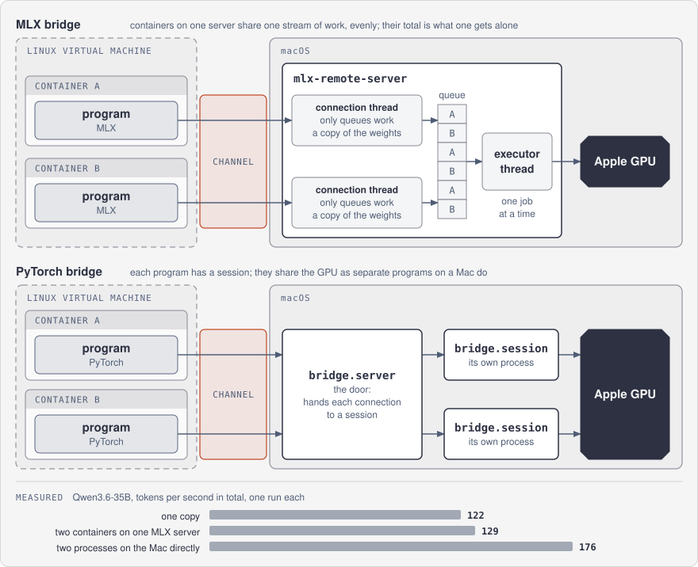

# Use case 6: several containers at once

**What you get**

- Several containers computing at once on one MLX server, each with an even
  share: with two containers each finished its 8 generations in 11.5 s,
  and with three in 17.4 s (Qwen3.6-35B, Kiri, one run each).
- The same text alone and with others running: one digest in every run.
- A container that dies does not take the others with it. When one of two
  was killed half way, the other went from 71 to 140 tokens per second
  within one generation, as mlx-lm reports the rate of each generation,
  with the right text, and the server stayed up.

**Compared with**

- The same programs installed on the Mac as separate processes: two reach
  176 tokens per second in total and three reach 166, where two and three
  containers on one server reach 129 and 128.
- A model server on the Mac called over the network, which batches: 216.0
  tokens per second in total with 4 requests at once, from one copy of the
  weights. The same server in a container reaches 215.0.

**When it is not the right tool:** for the most tokens per second from one
model. One batching model server gives 215 where two containers on one
bridge server give 129.

**Who it is for.** Anyone who plans to run more than one GPU workload in
containers on one Mac, and needs to know what to expect before choosing
between several containers and one server.

## The short answer

<picture>
  <source media="(prefers-color-scheme: dark)" srcset="../assets/several-containers-dark.svg">
  
</picture>

The three totals in the figure were measured with Qwen3.6-35B at MLX
protocol 9, on an Apple M4 Max with 128 GB, the containers in Kiri with 6
CPUs, in one run for each configuration ([Measured](#measured)).

- Several containers on **one MLX server** share one stream of work. Each
  gets an even share, and the total is what one gets alone.
- Several **separate programs** on one Apple GPU (processes on the Mac, a
  server per container, PyTorch containers) reach about 1.4 times one, and
  a third adds nothing. The sharing is not even.
- **One model server that batches** does better than either: 215 tokens per
  second with 4 requests at once.
- **Memory** is the next limit: every container that loads a model has its
  own copy of the weights on the Mac.

## What runs

[`examples/06-several-containers/run.sh`](../../examples/06-several-containers/run.sh)
starts one bridge server and N containers, each running an ordinary mlx-lm
generation loop on its own copy of a model
([`mlx/tests/multi_gen.py`](../../mlx/tests/multi_gen.py)). The copies load,
then all start at the same moment. It runs first one copy, then N.

## Commands

```sh
examples/06-several-containers/run.sh              # 1, then 2 containers, the small model
examples/06-several-containers/run.sh mac          # 1, then 2 processes on the Mac
examples/06-several-containers/run.sh 3            # 1, then 3 containers
ENGINE=kiri examples/06-several-containers/run.sh  # 1, then 2 containers in Kiri
```

With a large model, mind the memory: N copies are loaded. The measurements
below used `mlx-community/Qwen3.6-35B-A3B-4bit`, 19.5 GB a copy:

```sh
examples/06-several-containers/run.sh 2 mlx-community/Qwen3.6-35B-A3B-4bit   # not run for this page: two copies of the large model
```

## What you see

With the small model, on Docker Desktop:

```
=== 1 at once
SUMMARY docker1: load 0.6 s; 8 generations, 960 tokens in 5.0 s, 193.6 per second; ... texts ['84fbe2d14a5c']
TOTAL docker x1: 193.6 tokens per second added up; 1 distinct text(s)
=== 2 at once
SUMMARY docker1: load 0.7 s; 8 generations, 960 tokens in 8.7 s, 110.1 per second; ... texts ['84fbe2d14a5c']
SUMMARY docker2: load 0.7 s; 8 generations, 960 tokens in 8.7 s, 110.1 per second; ... texts ['84fbe2d14a5c']
TOTAL docker x2: 220.2 tokens per second added up; 1 distinct text(s)
```

Two containers each get half, evenly, and the text is the same alone and
with another container running (one digest). This is one run, shown as an
illustration. In the same session, with this small model, three containers
gave 220.4 in total, one process on the Mac 223.2, and two processes on the
Mac 280.1. One run in Kiri gave 194.1 for one container and 219.2 in total
for two.

## Measured

Qwen3.6-35B, 8 generations of 93 tokens per copy, tokens generated over the
time the generations took, added up over the copies. Kiri had 6 CPUs, and
each configuration was run once, at protocol 9
([benchmarks](../benchmarks.md#several-containers-at-once-and-where-it-stops-scaling)).

| Copies | Mac, processes | Kiri, containers on one server | Docker Desktop, a server per container |
|---|---|---|---|
| 1 | 122 | 122 | – |
| 2 | 176 (8.1 and 8.9 s) | 129 (11.5 s each) | about 170 while both ran (6.9 and 10.6 s) |
| 3 | 166 | 128 (17.4 s each) | 179 |
| 4 | – | – | 140 on two servers, with the Mac swapping |

- The text is the same everywhere: one digest in every run, alone or with
  other copies running.
- On one server the sharing is even. Each container took 11.5 s with two
  and 17.4 s with three, which is about 65 and 43 tokens per second each
  over the whole loop, the figure the table adds up.
- The rate mlx-lm reports for each generation is another measure: 71.1
  tokens per second in both containers with two, and 47.0 to 47.1 with
  three. It counts from a generation's first token to its last and leaves
  out the reading of the prompt, so it is higher than a container's share
  of the totals.
- A server per container gives the Mac's total, about 170–180, and the Mac's
  uneven sharing: one container finished in 6.9 s and the other in 10.6 s.
- The server had 36.7 GB resident with two containers. Four copies (78 GB)
  took 8–9 s to load instead of 2 and left 3.4 GB of swap in use.
- When one of two running containers was killed half way (`docker kill`),
  the other went from 71 to 140 tokens per second within one generation,
  as mlx-lm reports the rate of each generation, with the right text, and
  the server stayed up. The server's memory was
  given back when the last connection closed, not when the container went.

The alternative for throughput is one server that batches
([use case 2](openai-server.md)). It gave 216.0 tokens per second in total
on the Mac and 215.0 in the container with 4 requests at once, from one copy
of the weights.

Several threads in one program, sharing the weights, give right answers
through the bridge but less than one thread from three threads up (92.9 and
88.3 tokens per second with three and four threads, and 128.4 with one)
([benchmarks](../benchmarks.md#several-threads-in-one-process-one-copy-of-the-weights)).

## How to choose

| You want | Use |
|---|---|
| The most tokens per second from one model | One batching model server in one container |
| Several different models | A container each. Expect about 1.4 times the throughput of one in total, and mind the memory |
| Even sharing between containers | One bridge server for all of them |
| The Mac's total throughput for separate programs | A bridge server per container (`SERVER_NAME` and `--port` of `mlx/server/ctl.sh`) |
| Containers that do not trust each other | A bridge server per container, or per group that trusts each other ([security](../security.md#containers-that-share-one-mlx-server)) |
| Short requests while a long job runs | Expect the short ones to slow 5 to 8 times, as on the Mac itself ([apple-gpu-limits](../apple-gpu-limits.md#sharing-it-between-programs)) |

## Limits

- The one executor of the MLX server is why containers on it do not add up.
  What could change that is in the
  [roadmap](../roadmap.md#the-servers-one-executor), and the decision was
  not to build it.
- There are no quotas and no priorities. A container can take all the
  memory, and nothing puts one container's work ahead of another's.
- Containers on one MLX server are not separated from each other: an index
  out of range in a GPU operation can reach another connection's arrays,
  and a container that stops reading its answers delays the others
  ([security](../security.md#containers-that-share-one-mlx-server)).
- PyTorch containers each have a process on the Mac, so they behave as
  separate programs on a Mac do.
- The 1.4 was measured on one machine and belongs to this GPU. Another
  project's own figures, on another chip, put it at about 1.45
  ([related work](../related-work.md#how-other-engines-share-the-apple-gpu)).

Further measurements will be published as they are taken.
